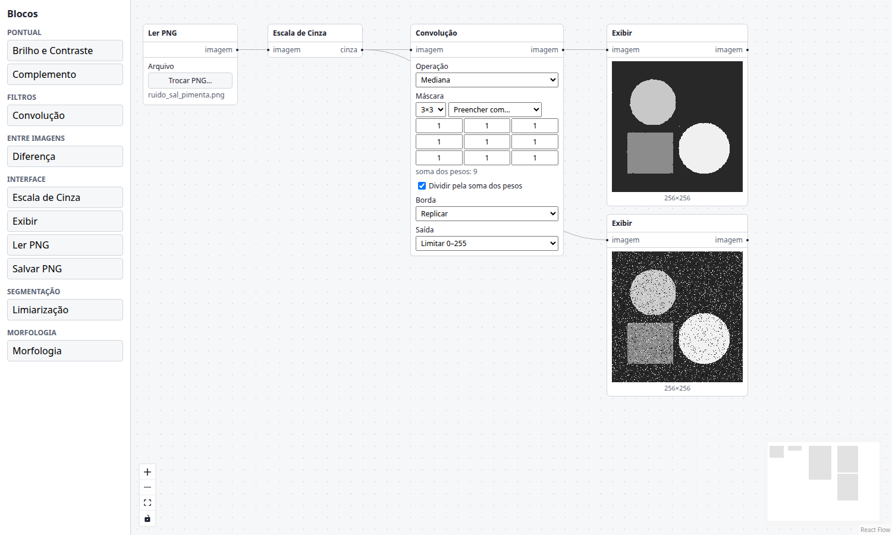

# Manual do PSE-Image

O PSE-Image monta fluxos de processamento de imagens ligando **blocos** num
canvas, sem programar. Cada bloco recebe uma imagem, aplica uma operação e
entrega o resultado para o próximo bloco.

## 1. Abrir

- **Executável:** abra `PSE-Image` (Windows: `PSE-Image.exe`). Uma janela de
  terminal mostra o endereço e o navegador abre sozinho. Para encerrar, feche a
  janela do terminal.
- **Pelo código-fonte:** veja [DEVELOPMENT.md](DEVELOPMENT.md#rodando).

## 2. A tela

| Área | O que faz |
|---|---|
| **Blocos** (esquerda) | Lista de blocos por categoria. Passe o mouse para ver a descrição. |
| **Canvas** (centro) | Onde o fluxo é montado. Arraste o fundo para mover; role para dar zoom. |
| Controles (canto inferior esquerdo) | Zoom, enquadrar tudo e travar o canvas. |
| Minimapa (canto inferior direito) | Visão geral do fluxo. |

Cada bloco (card) tem:

- **portas de entrada** à esquerda e **de saída** à direita (os pontos pretos);
- **parâmetros** (sliders, listas, caixas de seleção, campos);
- **miniatura** da imagem, nos blocos Exibir: clique para ver em tamanho real;
- **mensagens**: em vermelho, um erro (ex.: entrada sem imagem); em verde, uma
  informação (ex.: limiar escolhido, MSE/PSNR, arquivo salvo).

## 3. Montar um fluxo

1. **Adicionar bloco:** arraste da lista para o canvas, ou clique nele (entra no centro).
2. **Ligar blocos:** arraste de uma porta de saída até uma porta de entrada.
   Uma entrada aceita uma ligação só (a nova substitui a antiga); uma saída
   pode alimentar vários blocos. Ligações que formariam ciclo não são aceitas.
3. **Remover:** clique no bloco ou na ligação e tecle Delete (ou Backspace).
4. **Ajustar:** mude os parâmetros; o fluxo é recalculado na hora e só os
   blocos afetados executam de novo.

Fluxo mínimo: **Ler PNG → Escala de Cinza → Exibir**. Os blocos de
processamento trabalham em tons de cinza, então use a Escala de Cinza logo
depois de ler a imagem. Podem existir várias imagens e vários fluxos no mesmo
canvas.

## 4. Blocos

### Interface

| Bloco | Uso |
|---|---|
| **Ler PNG** | **Escolher PNG…** abre um arquivo PNG (colorido ou cinza). |
| **Escala de Cinza** | Converte para tons de cinza: Y = 0,299 R + 0,587 G + 0,114 B. |
| **Exibir** | Mostra a imagem no card (clique para tamanho real) e a repassa: pode ficar no meio do fluxo. |
| **Salvar PNG** | **Salvar** grava `<Caminho>/<Nome>.png`. Caminho vazio = pasta `img/` ao lado do programa. Repassa a imagem. |

### Processamento

| Bloco | Parâmetros |
|---|---|
| **Brilho e Contraste** | g = c·(f − 128) + 128 + b. **Brilho** b (−255 a 255) e **Contraste** c (0 a 3). |
| **Complemento** | Negativo: g = 255 − f. |
| **Convolução** | **Operação:** Convolução ou Mediana. **Máscara:** tamanho (3×3 a 9×9), **Preencher com…** (Média, Gaussiana, Laplaciano, Sobel, Nitidez, Identidade) e pesos editáveis um a um. **Dividir pela soma dos pesos** (ignorado quando a soma é 0). **Borda:** Replicar ou Zero. **Saída:** Limitar 0–255, Valor absoluto (bordas) ou Normalizar mín–máx. A Mediana usa só o tamanho da máscara. |
| **Limiarização** | Segmentação: tom maior que o limiar vira branco (objeto), o resto preto. **Método:** Otsu (automático) ou Manual (**Limiar** 0–255). **Inverter** para objeto escuro. Mostra o limiar usado. |
| **Morfologia** | **Operação:** Erosão, Dilatação, Abertura (remove pontos soltos) ou Fechamento (fecha buracos). **Elemento:** Quadrado, Cruz ou Disco. **Tamanho:** 3×3 a 9×9. Use em imagem binária (depois da Limiarização) ou em tons de cinza. |
| **Diferença** | Entradas A e B, do mesmo tamanho. **Modo:** Absoluta \|A − B\| ou Com sinal (cinza = iguais). Mostra **MSE** e **PSNR**. |

## 5. Avaliar os resultados

- Coloque blocos **Exibir** em qualquer ponto do fluxo para comparar etapas lado a lado.
- Clique na miniatura para ver a imagem em tamanho real.
- Use **Diferença** entre a imagem original (ou de referência) e o resultado:
  quanto menor o **MSE** e maior o **PSNR**, mais parecidas as imagens.

## 6. Exemplos com a base de imagens (`samples/`)

| Objetivo | Fluxo |
|---|---|
| Remover ruído sal e pimenta | `ruido_sal_pimenta.png` → Escala de Cinza → Convolução (Mediana, 3×3) → Exibir |
| Suavizar ruído gaussiano | `ruido_gaussiano.png` → Escala de Cinza → Convolução (Gaussiana 5×5) → Exibir |
| Realçar bordas | `xadrez.png` → Escala de Cinza → Convolução (Laplaciano, saída Valor absoluto) → Exibir |
| Aumentar contraste | `baixo_contraste.png` → Escala de Cinza → Brilho e Contraste (contraste 3) → Exibir |
| Segmentar e limpar | `cena_a.png` → Escala de Cinza → Limiarização (Otsu) → Morfologia (Abertura) → Exibir |
| Comparar imagens | `cena_a.png` e `cena_b.png` → Escala de Cinza (cada uma) → Diferença (A, B) → Exibir |

## 7. Problemas comuns

| Mensagem ou sintoma | O que fazer |
|---|---|
| "entrada 'imagem' sem imagem" | Ligue a entrada do bloco (ou escolha um arquivo no Ler PNG). |
| "entrada ... é colorida" | Coloque um bloco Escala de Cinza antes. |
| "tamanhos diferentes" (Diferença) | Use imagens com as mesmas dimensões. |
| Ligação vermelha tracejada | A ligação foi recusada; o motivo aparece nela. |
| "Backend indisponível" | O programa foi fechado: abra de novo e recarregue a página. |
